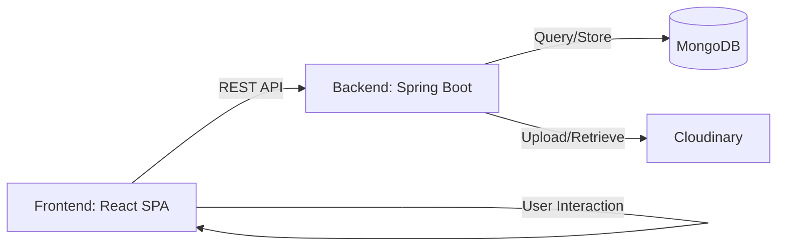

# 🎨 Matty Graphic Design Studio
> **Empower Your Creativity with Professional Design Tools.**

[](https://reactjs.org/)
[](https://spring.io/projects/spring-boot)
[](https://www.mongodb.com/)
[](https://tailwindcss.com/)
[](https://opensource.org/licenses/MIT)

---

## 🌟 Overview

**Matty** is a state-of-the-art, full-stack graphic design platform designed for creators, marketers, and entrepreneurs. It combines a powerful browser-based editor with a robust backend to provide a frictionless, professional environment for high-quality creative work.

### Why Matty?
In an era where visual content is king, Matty bridges the gap between complex professional software and overly simplistic consumer tools. It offers:
- **Corporate Modern Aesthetics**: A premium glassmorphic UI that stays out of your way.
- **High Performance**: Built with Vite and Spring Boot for lightning-fast interactions.
- **Cloud-Ready**: Integrated with Cloudinary for seamless asset management.

---

## 🚀 Quick Start

Get Matty up and running on your local machine in minutes.

### 1. Backend Setup
```bash
cd backend
./mvnw spring-boot:run
```

### 2. Frontend Setup
```bash
cd frontend
npm install
npm run dev
```

---

## ✨ Features

| Feature | Description |
| :--- | :--- |
| **Interactive Editor** | Advanced canvas using Fabric.js and Excalidraw integration. |
| **Glassmorphic UI** | Premium dark-themed editor workspace for reduced eye strain. |
| **Asset Management** | Secure image uploads and management via Cloudinary. |
| **Templates** | Library of professional templates to kickstart your projects. |
| **Project Dashboard** | Organize, duplicate, and manage your designs in one place. |
| **User Auth** | Secure JWT-based authentication and profile management. |
| **Admin Control** | Dedicated admin panel for user management and platform stats. |
| **Responsive Design** | Fully optimized for desktop and mobile workflows. |

---

## 🛠 Tech Stack

### Frontend
- **Framework**: [React 19](https://reactjs.org/)
- **Build Tool**: [Vite](https://vitejs.dev/)
- **Styling**: [Tailwind CSS](https://tailwindcss.com/)
- **State Management**: [Redux Toolkit](https://redux-toolkit.js.org/)
- **Canvas Engine**: [Fabric.js](http://fabricjs.com/) & [Excalidraw](https://excalidraw.com/)
- **Icons**: [Lucide React](https://lucide.dev/)

### Backend
- **Framework**: [Spring Boot 3.2.5](https://spring.io/projects/spring-boot)
- **Language**: Java 17
- **Security**: Spring Security + JWT (jjwt)
- **Database**: [MongoDB](https://www.mongodb.com/)
- **Asset Storage**: [Cloudinary](https://cloudinary.com/)
- **Build Tool**: Maven

---

## 🏗 System Architecture

Matty follows a modern decoupled architecture:



1.  **Frontend (React SPA)**: Handles the UI/UX and complex canvas logic. Communicates with the backend via RESTful APIs.
2.  **Backend (Spring Boot)**: Manages business logic, authentication, and database interactions.
3.  **Data Layer (MongoDB)**: Stores user data, project metadata, and template definitions.
4.  **Storage Layer (Cloudinary)**: Handles high-resolution image uploads and transformations.

### Folder Structure
```text
matty/
├── backend/                # Spring Boot Backend API
│   ├── src/                # Java source files (Controller, Service, Repository, Model)
│   ├── pom.xml             # Maven dependencies & build config
│   └── uploads/            # Local temporary storage for uploads
├── frontend/               # Vite + React Frontend
│   ├── src/                # React components, pages, and services
│   ├── public/             # Static assets (favicons, etc.)
│   ├── tailwind.config.js  # Design system configuration
│   └── package.json        # Frontend dependencies
├── design.md               # Detailed Design System & UI Specs
└── README.md               # Project Documentation
```

---

## ⚙️ Environment Variables

### Backend (`backend/src/main/resources/application.properties`)
| Variable | Description | Default |
| :--- | :--- | :--- |
| `server.port` | Backend server port | `8080` |
| `spring.data.mongodb.uri` | MongoDB connection string | `mongodb://localhost:27017/matty` |
| `jwt.secret` | Secret key for JWT signing | `Base64 Encoded String` |
| `cloudinary.cloud-name` | Cloudinary Cloud Name | `Required` |
| `cloudinary.api-key` | Cloudinary API Key | `Required` |
| `cloudinary.api-secret`| Cloudinary API Secret | `Required` |

---

## 📸 Screenshots / UI Preview

> [!NOTE]
> Screenshots are located in the `/docs/screenshots` directory.

| Dashboard | Editor Workspace |
| :---: | :---: |
|  |  |

---

## 🔌 API Documentation

| Endpoint | Method | Description | Auth |
| :--- | :--- | :--- | :--- |
| `/api/auth/login` | `POST` | User login | 🔓 |
| `/api/designs` | `GET` | List user designs | 🔒 |
| `/api/designs` | `POST` | Create new design | 🔒 |
| `/api/templates` | `GET` | Get all templates | 🔓 |
| `/api/upload/image`| `POST` | Upload image to Cloudinary | 🔒 |
| `/api/admin/stats` | `GET` | Get platform statistics | 🔒 Admin |

---

## 🛡 Security & Performance

### Security
- **JWT Authentication**: Secure stateless authentication for all protected routes.
- **Password Hashing**: BCrypt encryption for user credentials.
- **CORS Configuration**: Restrictive origins for cross-domain requests.
- **Input Validation**: Spring Validation for all API payloads.

### Performance
- **Vite Build**: Optimized frontend chunks for fast load times.
- **MongoDB Indexing**: Optimized queries for project and template retrieval.
- **Cloudinary Optimization**: Automatic image scaling and format delivery.

---

## 🗺 Roadmap & Future Improvements
- [ ] **AI-Powered Design Suggestions**: Integration with Gemini/OpenAI for layout generation.
- [ ] **Real-time Collaboration**: Multi-user editing using WebSockets.
- [ ] **Export to Multiple Formats**: PDF, SVG, and high-res Print formats.
- [ ] **Expanded Template Library**: More categories for social media and business cards.

---

## 🤝 Contributing

Contributions are welcome! Please follow these steps:
1. Fork the Project
2. Create your Feature Branch (`git checkout -b feature/AmazingFeature`)
3. Commit your Changes (`git commit -m 'Add some AmazingFeature'`)
4. Push to the Branch (`git push origin feature/AmazingFeature`)
5. Open a Pull Request

---

## 📄 License

Distributed under the **MIT License**. See `LICENSE` for more information.

---

## 👤 Author

**Vivek Yadav**
- GitHub: [@github_username](https://github.com/your-username)
- LinkedIn: [Your Profile](https://linkedin.com/in/your-profile)
- Email: your.email@example.com

---

## 🙏 Acknowledgements
- [Fabric.js](http://fabricjs.com/) for the powerful canvas engine.
- [Spring Boot](https://spring.io/) for the robust backend.
- [Tailwind CSS](https://tailwindcss.com/) for the beautiful UI components.
- Inspiration from Canva and Adobe Express.
