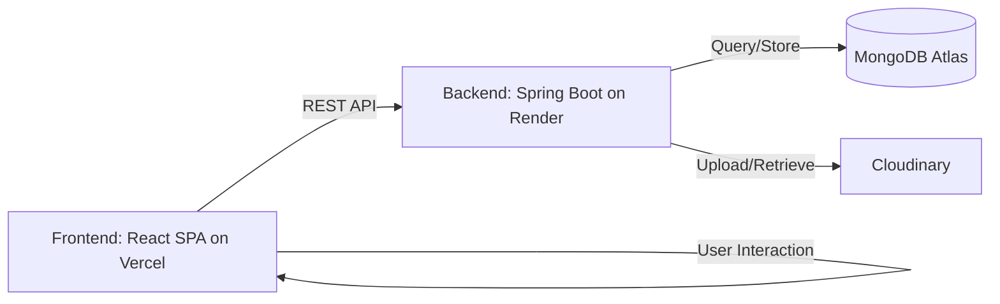

# 🎨 Matty Graphic Design Studio
> **Empower Your Creativity with Professional Design Tools.**

[](https://reactjs.org/)
[](https://spring.io/projects/spring-boot)
[](https://www.mongodb.com/)
[](https://tailwindcss.com/)
[](https://cloudinary.com/)

---

## 🌟 Overview

**Matty** is a state-of-the-art, full-stack graphic design platform designed for creators, marketers, and entrepreneurs. It combines a powerful browser-based editor with a robust backend to provide a frictionless, professional environment for high-quality creative work.

### Why Matty?
In an era where visual content is king, Matty bridges the gap between complex professional software and overly simplistic consumer tools. It offers:
- **Corporate Modern Aesthetics**: A premium glassmorphic UI that stays out of your way.
- **High Performance**: Built with Vite and Spring Boot for lightning-fast interactions.
- **Cloud-Ready**: Integrated with Cloudinary for seamless asset management and deployed on Vercel/Render.

---

## 🚀 Recent Updates & Achievements

The project has recently undergone significant improvements to make it production-ready:

1. **Cloudinary Asset Management**: Replaced local file system uploads with Cloudinary. This ensures that user profile pictures, template thumbnails, and design assets are persistently and securely stored in the cloud, resolving previous `403 Forbidden` local storage errors and preventing data loss on redeployment.
2. **Production Deployment Configuration**:
   - **Backend**: Configured for deployment on **Render** via Docker. Added a comprehensive `Dockerfile` and `render.yaml` to force a Java environment and securely inject environment variables like MongoDB URIs and Cloudinary credentials.
   - **Frontend**: Configured for deployment on **Vercel** with a custom `vercel.json` to handle React Router rewrites (`/index.html` fallback), ensuring seamless client-side navigation in production.
3. **UI/UX Polish**: Implemented a cohesive, premium dark-themed glassmorphic design system across the Dashboard, Editor, Profile, and Admin pages, ensuring visual consistency and professional appeal.
4. **CORS Security**: Fortified CORS settings in Spring Boot to safely accept communication from specific production and local origins, securing the JWT authentication flow.

---

## ✨ Features

| Feature | Description |
| :--- | :--- |
| **Interactive Editor** | Advanced canvas using Fabric.js and Excalidraw integration. |
| **Glassmorphic UI** | Premium dark-themed editor workspace for reduced eye strain. |
| **Cloud Asset Management** | Secure, persistent image uploads via Cloudinary API. |
| **Templates** | Library of professional templates to kickstart your projects. |
| **Project Dashboard** | Organize, duplicate, and manage your designs in one place. |
| **User Auth** | Secure stateless JWT-based authentication and profile management. |
| **Admin Control** | Dedicated admin panel for user management and platform stats. |
| **Responsive Design** | Fully optimized for desktop and mobile workflows. |

---

## 🛠 Tech Stack

### Frontend
- **Framework**: React 19
- **Build Tool**: Vite
- **Styling**: Tailwind CSS
- **State Management**: Redux Toolkit
- **Canvas Engine**: Fabric.js & Excalidraw
- **Deployment**: Vercel

### Backend
- **Framework**: Spring Boot 3.2.5 (Java 17)
- **Security**: Spring Security + JWT (jjwt)
- **Database**: MongoDB (Atlas)
- **Asset Storage**: Cloudinary
- **Deployment**: Render (Docker container)

---

## 🏗 System Architecture

Matty follows a modern decoupled architecture:



1. **Frontend (React SPA)**: Handles the UI/UX and complex canvas logic. Communicates with the backend via RESTful APIs.
2. **Backend (Spring Boot)**: Manages business logic, authentication, and database interactions.
3. **Data Layer (MongoDB)**: Stores user data, project metadata, and template definitions.
4. **Storage Layer (Cloudinary)**: Handles high-resolution image uploads and transformations.

### Folder Structure
```text
matty/
├── backend/                # Spring Boot Backend API
│   ├── src/                # Java source files (Controller, Service, Config)
│   ├── pom.xml             # Maven dependencies
│   └── Dockerfile          # Production Docker configuration
├── frontend/               # Vite + React Frontend
│   ├── src/                # React components and pages
│   ├── tailwind.config.js  # Design system configuration
│   ├── package.json        # Frontend dependencies
│   └── vercel.json         # Vercel deployment configuration
├── render.yaml             # Render deployment blueprint
├── design.md               # Detailed Design System & UI Specs
└── README.md               # Project Documentation
```

---

## ⚙️ Local Development Setup

### 1. Backend Setup
Navigate to the backend directory and set up your environment variables (in `src/main/resources/application.properties` or via system environment variables):
```bash
cd backend
./mvnw spring-boot:run
```
Required environment variables (see `backend/.env.example`):
- `MONGODB_URI` (MongoDB connection URI, e.g. MongoDB Atlas)
- `JWT_SECRET` (Base64-encoded JWT signing secret)
- `CLOUDINARY_CLOUD_NAME`, `CLOUDINARY_API_KEY`, `CLOUDINARY_API_SECRET`
- `ALLOWED_ORIGINS` (Allowed CORS origins, e.g. `http://localhost:5173,https://matty.vercel.app`)
- `APP_OAUTH2_AUTHORIZED_REDIRECT_URI` (Frontend redirect target, e.g. `http://localhost:5173/oauth2/redirect`)
- `GOOGLE_CLIENT_ID`, `GOOGLE_CLIENT_SECRET` (Google OAuth 2.0 credentials)
- `GITHUB_CLIENT_ID`, `GITHUB_CLIENT_SECRET` (GitHub OAuth App credentials)

### 2. Frontend Setup
Navigate to the frontend directory, install dependencies, and start the development server:
```bash
cd frontend
npm install
npm run dev
```
Make sure to set `VITE_API_URL=http://localhost:8080/api` in `.env` in the frontend folder if your backend is running locally.

---

## 🚀 Deployment Instructions

### Deploying the Backend (Render)
1. Connect your GitHub repository to [Render](https://render.com/).
2. Render will automatically detect the `render.yaml` blueprint.
3. Configure the required environment variables in Render:
   - `MONGODB_URI`, `JWT_SECRET`, `CLOUDINARY_*`, `ALLOWED_ORIGINS`
   - `APP_OAUTH2_AUTHORIZED_REDIRECT_URI=https://<your-vercel-app>.vercel.app/oauth2/redirect`
   - `GOOGLE_CLIENT_ID`, `GOOGLE_CLIENT_SECRET`
   - `GITHUB_CLIENT_ID`, `GITHUB_CLIENT_SECRET`
4. Register the OAuth callback URLs in your provider developer consoles:
   - Google Cloud Console: `https://<your-render-backend-url>/login/oauth2/code/google`
   - GitHub OAuth App: `https://<your-render-backend-url>/login/oauth2/code/github`

### Deploying the Frontend (Vercel)
1. Connect your GitHub repository to [Vercel](https://vercel.com/).
2. Set the framework preset to **Vite**.
3. Add `VITE_API_URL=https://<your-render-backend-url>/api` to Environment Variables.
4. The included `vercel.json` automatically handles routing configurations so direct navigation to subpages (like `/dashboard` and `/oauth2/redirect`) works without 404 errors.

---

## 🔌 API Documentation

| Endpoint | Method | Description | Auth |
| :--- | :--- | :--- | :--- |
| `/api/auth/register` | `POST` | User registration (normalized email, BCrypt) | 🔓 |
| `/api/auth/login` | `POST` | User login (email & password) | 🔓 |
| `/api/auth/me` | `GET` | Get authenticated user profile & provider info | 🔒 |
| `/api/auth/link-account` | `POST` | Verify password and link OAuth provider to account | 🔓 |
| `/api/auth/oauth2/authorize/{provider}` | `GET` | Initiates Google or GitHub OAuth flow | 🔓 |
| `/login/oauth2/code/{provider}` | `GET` | Spring Security OAuth2 callback endpoint | 🔓 |
| `/api/designs` | `GET/POST` | List or create designs | 🔒 |
| `/api/templates` | `GET` | Get all templates | 🔓 |
| `/api/upload/image`| `POST` | Upload image to Cloudinary | 🔒 |
| `/api/admin/stats` | `GET` | Get platform statistics | 🔒 Admin |

---

## 🗺 Roadmap & Future Improvements
- [ ] **AI-Powered Design Suggestions**: Integration with Gemini/OpenAI for layout generation.
- [ ] **Real-time Collaboration**: Multi-user editing using WebSockets.
- [ ] **Export to Multiple Formats**: PDF, SVG, and high-res Print formats.
- [ ] **Expanded Template Library**: More categories for social media and business cards.

---

## 📄 License
Distributed under the **MIT License**. See `LICENSE` for more information.

## 👤 Author
**Vivek Yadav**
- GitHub: [@vivekYadav129](https://github.com/vivekYadav129)

---

## 🙏 Acknowledgements
- [Fabric.js](http://fabricjs.com/) for the powerful canvas engine.
- [Spring Boot](https://spring.io/) for the robust backend.
- [Tailwind CSS](https://tailwindcss.com/) for the beautiful UI components.
- [Cloudinary](https://cloudinary.com/) for flawless asset delivery.
